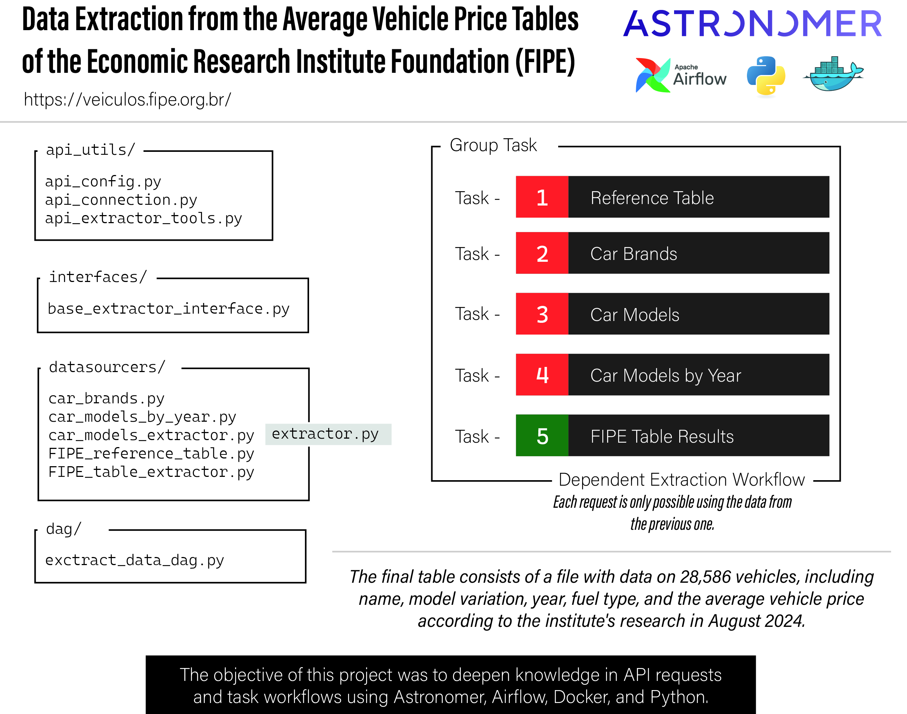

# FIPE Vehicle Price Extractor — Apache Airflow on Astronomer

Data pipeline that extracts Brazil's average vehicle price tables from the **FIPE API** (*Fundação Instituto de Pesquisas Econômicas* — [veiculos.fipe.org.br](https://veiculos.fipe.org.br/)), orchestrated with **Apache Airflow** running on the **Astronomer** (Astro CLI) environment for easy workflow management and deployment.



## Features

- Extraction of reference tables, brands, models, model years and price results.
- Processing of the extracted data and storage as JSON and CSV.
- Structured logging to monitor each run.
- Detailed error handling for API requests.
- **Template Method** design pattern: a base extractor interface defines the flow, and each endpoint implements its own specifics.

## Project structure

```
├── dags/
│   ├── extract_data_dag.py              # Airflow DAG
│   └── include/
│       ├── interfaces/                  # Base extractor interface (Template Method)
│       ├── datasources/endpoints/       # One class per FIPE API endpoint
│       └── api_utils/                   # API connection, config and helper tools
├── Dockerfile · requirements.txt · packages.txt
├── airflow_settings.yaml
└── docs/                                # Pipeline diagram
```

## Prerequisites

- Docker
- Astro CLI

## Running on Ubuntu

1. Clone the project:
   ```bash
   git clone https://github.com/devguilhermecarvalho/astro_api_fipe_extractor.git
   cd astro_api_fipe_extractor
   ```
2. Install the Astro CLI:
   ```bash
   curl -sSL https://install.astronomer.io | sudo bash
   ```
3. Create the virtual environment and install dependencies:
   ```bash
   python3 -m venv venv
   source venv/bin/activate
   pip install -r requirements.txt
   ```
4. Start Airflow:
   ```bash
   astro dev start
   ```
   Then open http://localhost:8080.
5. In the Airflow UI, enable the `extract_data_dag` DAG and wait for it to run.
6. Stop the environment:
   ```bash
   astro dev stop
   ```

## Contact

**Guilherme Carvalho** — Senior Data & AI Engineer
LinkedIn: [linkedin.com/in/devguilhermecarvalho](https://www.linkedin.com/in/devguilhermecarvalho/)
